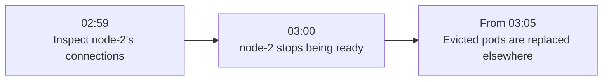

# toposhift

toposhift records how Kubernetes infrastructure was connected, so you can ask what existed together at a past instant or over a window.

What was running on this node before it stopped being ready? Which pods shared a host at the same time? What changed between two observations?

It records assertions about pods, nodes, containers, hosts and services, then answers historical questions through the Model Context Protocol (MCP). Every record has an event time and an ingest sequence. Paths require overlapping lifetimes; computed answers, including possible blast radius, are labelled derived and never stored as facts.

**Status: early.** There is no authentication. Read tools are served only on loopback, and ingest accepts whatever reaches it. Interfaces, answers and the store format may change between releases. See [Known shortcomings](#known-shortcomings) before collecting real data.

[Try it](#try-it-without-a-cluster) · [Tools](#what-it-answers) · [Run it](#run-it-on-a-cluster) · [Install](#install) · [Retention](#retention) · [Research](#research-and-design-decisions) · [Docs](#documentation)

## Try it without a cluster

The bundled demo builds a synthetic cluster in memory through the same translators and sequencer as real ingest. It needs no cluster or data directory and writes nothing to disk. Its history runs from 2026-10-01T00:00:00Z to 2026-10-01T06:00:00Z.

**Synthetic demo · 1 October 2026 · UTC**



DaemonSet pods remain on node-2. Replacements have their own identities; an old pod becoming absent and a new one appearing are separate events. This fixed story demonstrates historical queries, rather than measuring real application failure. The [system overview](docs/architecture.md) explains the collection and storage behind them.

### Start the demo

You need git, curl and Go 1.27.4 or newer; Go 1.21 or newer can fetch the required toolchain unless `GOTOOLCHAIN=local`.

```sh
git clone https://github.com/lotannauo/toposhift
cd toposhift
CGO_ENABLED=0 go build -trimpath -o bin/toposhift ./cmd/toposhift
./bin/toposhift demo
```

This builds the checked-out code. `demo` serves MCP at `http://127.0.0.1:7070/mcp` on loopback and prints three questions. In another terminal, follow the investigation below.

### 1. Find the node

Which node named `node-2` existed one minute before it stopped being ready?

```sh
curl -s -X POST http://127.0.0.1:7070/mcp \
  -H 'Content-Type: application/json' \
  -H 'Accept: application/json, text/event-stream' \
  -d '{"jsonrpc":"2.0","id":1,"method":"tools/call","params":{"name":"find_entities","arguments":{"type":"k8s.node","name":"node-2","at":"2026-10-01T02:59:00Z"}}}'
```

Its ID in this demo is `k8s.node:3c5919a8fa3541cd06c41e864b40a22f`. For your own observations, use the returned ID.

### 2. Inspect its connections

What was connected to that node at the same instant?

```sh
curl -s -X POST http://127.0.0.1:7070/mcp \
  -H 'Content-Type: application/json' \
  -H 'Accept: application/json, text/event-stream' \
  -d '{"jsonrpc":"2.0","id":1,"method":"tools/call","params":{"name":"neighbors_at","arguments":{"entity":"k8s.node:3c5919a8fa3541cd06c41e864b40a22f","at":"2026-10-01T02:59:00Z"}}}'
```

### 3. Ask about possible exposure

What could its failure have reached over the first half hour?

```sh
curl -s -X POST http://127.0.0.1:7070/mcp \
  -H 'Content-Type: application/json' \
  -H 'Accept: application/json, text/event-stream' \
  -d '{"jsonrpc":"2.0","id":1,"method":"tools/call","params":{"name":"blast_radius","arguments":{"entity":"k8s.node:3c5919a8fa3541cd06c41e864b40a22f","from":"2026-10-01T03:00:00Z","to":"2026-10-01T03:30:00Z"}}}'
```

The result describes possible exposure under the recorded relations. In this demo, a node's failure reaches its pods, containers and service instances; it does not follow an instance to its service. Actual application failure needs separate evidence.

In each reply, `result.structuredContent` holds the answer and `result.content[0].text` is its text twin. With jq installed, append `| jq .result.structuredContent` to a curl command.

### Keep the question with its evidence

For the last query, a small investigation receipt would retain:

| Part | What to save |
|---|---|
| Question | Possible exposure from node-2 during 03:00–03:30 UTC in the synthetic history above |
| Request | The exact tool name and arguments, including entity ID, window and any limits |
| Knowledge | The answer's returned `token`, `policy` and the build version or commit used |
| Evidence and limits | The complete answer, including member provenance, `counts` and `notes` |

Save the returned token rather than inventing one from a clock time. Reusing it as `asof` requires the same store history and query policies, with the needed records still retained. The [MCP guide](docs/mcp.md#keeping-an-investigation-reproducible) explains how to keep and repeat an investigation.

### Connect a client

For a client that starts an MCP server, use the absolute path to your binary:

```json
{"mcpServers":{"toposhift":{"command":"/absolute/path/to/bin/toposhift","args":["demo","--stdio"]}}}
```

An HTTP client uses the URL above. Try asking what node-2 was connected to one minute before it stopped being ready.

Every HTTP request needs both headers. For a 415, check `Content-Type`; for a 400, check the response message and `Accept` header. If port 7070 is taken, run `./bin/toposhift demo --listen 127.0.0.1:7071` and change the URLs. `./bin/toposhift demo help` lists the rest.

## What it answers

| Tool | Question |
|---|---|
| `find_entities` | Which entities have a name containing some text? |
| `neighbors_at` | What was an entity connected to at an instant? |
| `blast_radius` | What could a failure have reached over a window? |
| `co_residents` | Which pods shared a node or host with a pod at the same time? |
| `service_context` | What were a service's callers, callees and co-residents? |
| `what_changed` | What changed between two instants? |
| `entity_history` | When did an entity exist, and why did spans end? |
| `resolve_entity` | What is an entity's ID, given its identifying attributes? |
| `describe_schema` | What entity and relation types exist, and how are answers interpreted? |

`"derived": true` identifies a computed answer. The [MCP reference](docs/mcp.md) covers arguments, transports and limits; [how answers are derived](docs/how-it-works.md) explains lifetimes, knowledge tokens and interval overlap. Builds of main also expose four fixed [JSON subgraph routes](docs/api.md).

## Run it on a cluster

```sh
./bin/toposhift serve
curl http://127.0.0.1:7070/healthz
```

`serve` starts with zero configuration: it listens on `127.0.0.1:7070`, keeps a local Pebble store under `$HOME/.local/share/toposhift`, receives OpenTelemetry logs and metrics, and serves the tools at `/mcp`. The [collector setup](deploy/otel-collector/README.md) covers Kubernetes objects, optional host agents and optional service traces.

A collector in a cluster needs `--listen` or `TOPOSHIFT_LISTEN` on a reachable address. A non-loopback listener accepts ingest but leaves read tools and JSON subgraph routes unmounted. To ingest and query through one `serve`, the collector must reach its loopback listener, for example on the same machine or through a forwarded port. Anything reaching that forward can reach every mounted route. See the [listener model](docs/operate.md#loopback-and-the-tools) before deployment.

A service call or instance ends 6 hours after its last sighting by default. Expiry, collector requirements and startup behavior are in [operation](docs/operate.md).

## Install

To install the latest tagged release:

```sh
CGO_ENABLED=0 go install github.com/lotannauo/toposhift/cmd/toposhift@latest
```

In a checkout, `mise install && mise run build` writes `bin/toposhift`. See [builds](docs/operate.md#builds).

The current release and main have different behavior:

| Capability or default | v0.1.0, currently `@latest` | Main |
|---|---|---|
| Automatic retention | Off by default; history keeps growing | On by default |
| JSON subgraph routes | Unavailable | Four routes on loopback |

## Retention

`serve` can discard old history once a day: pods, nodes, containers and services keep 30 days; hosts keep 90 days; physical-fabric history is kept. `--retain on` or `off`, or `TOPOSHIFT_RETAIN`, chooses the mode; the flag wins.

Releases made before background retention passes its CI latency gate ship with retention off. That gate has not passed. Builds of a `release-*` branch have the release default too; builds of main retain by default.

`GET /status` reports the effective mode and what set it. A release with the default unchanged reports `"retention":{"mode":"off","set_by":"default"}`. See [retention](docs/operate.md#retention) for horizons and their effect on old questions.

## Research and design decisions

The storage design has been compared with per-edge versioning and native database representations. The useful result is a more specific claim about where this design helps and what remains unresolved.

### What changed our mind

| Finding | What it changes about the decision |
|---|---|
| On CI, checkpointed per-entity history had lower query timings than per-edge versioning and the same layout without checkpoints on the registered primary warm reverse reads in seven-day spike stores. | A benefit for those questions. Some secondary cells favored per-edge versioning; this did not measure `serve` or MCP. |
| Bulk-loaded native Postgres interval tables with GiST indexes bounded read work on the projected synthetic plans. | The earlier advantage over per-edge versioning does not establish an advantage over native interval designs. |
| A report-only retention test through the product-store benchmark adapter, without a boot key, observed write latency above its printed reference lines. | The intended serving configuration still needs validation; this observation is not a formal store-gate verdict. |

The [warm-read figure and comparison limits](bench/findings/2026-11-warm-reads.md) show the repeated-job variation. These are separate experiments at named commits and configurations. They do not establish a product-wide latency figure or a general database ranking. The [findings index](bench/findings/README.md) connects the current synthesis, detailed evidence and historical report, including the rejected tuning directions and unanswered questions.

## Known shortcomings

- No authentication; ingest routes accept whatever reaches them.
- Read tools and JSON subgraph routes are available only on loopback.
- No UI. HTTP questions use MCP or the four fixed subgraph routes on main.
- A call stops after 30 seconds with no partial answer.
- Range answers that reach a host cost more as its retained history grows; in v0.1.0 this also applies to other entities.
- Local backup shares the store's volume and does not protect against losing that volume.

See [all current limits](docs/limits.md) and the research report's [evidence limits](bench/findings/REPORT.md#what-this-does-not-show).

## Documentation

| Read | To learn |
|---|---|
| [System overview](docs/architecture.md) | Collection, durable writes, reads and component ownership |
| [MCP reference](docs/mcp.md) | Tools, transports and reproducible investigations |
| [How answers are derived](docs/how-it-works.md) | Facts, lifetimes, knowledge tokens and interval overlap |
| [Operation](docs/operate.md) | Running `serve`, retention, expiry and backup limits |
| [Current limits](docs/limits.md) | What is unavailable or still unresolved |
| [Collector setup](deploy/otel-collector/README.md) | Feeding observations to `serve` |
| [Findings](bench/findings/README.md) | Current learning, measured scope and historical evidence |

The [documentation map](docs/README.md) has reading paths for trying, operating and contributing.

## Contributing, security, license

[CONTRIBUTING.md](CONTRIBUTING.md); contributors and coding agents start with [AGENTS.md](AGENTS.md), then [docs/](docs/README.md). [SECURITY.md](SECURITY.md). Apache-2.0: [LICENSE](LICENSE).
