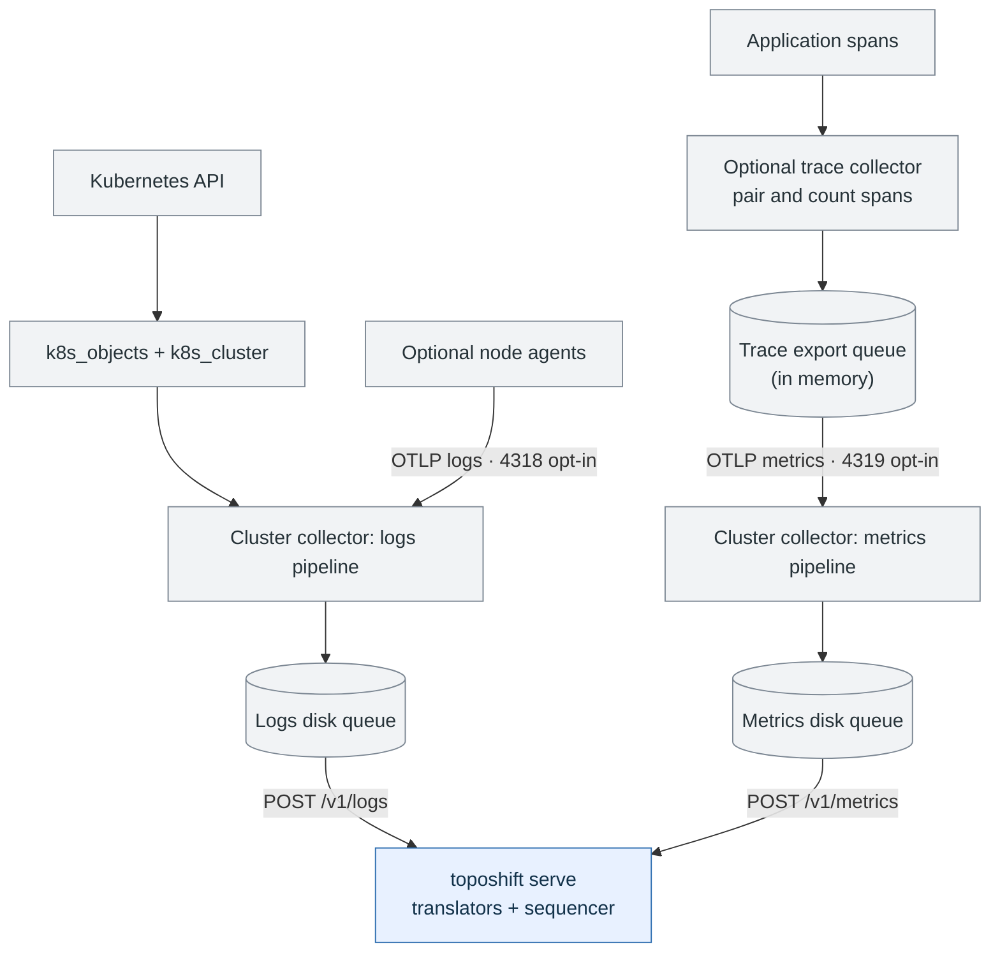

<a id="opentelemetry-collector-configuration-for-toposhift"></a>

# Collect Kubernetes topology

Use [toposhift.yaml](toposhift.yaml) with OpenTelemetry Collector Contrib **0.162.0** to send Kubernetes history to toposhift. Start with one cluster collector per cluster. Add the optional collectors only when you need their facts:

| Collect | Configuration | Setup |
| --- | --- | --- |
| Pods, nodes and containers | `toposhift.yaml` | This page and [read permissions](rbac.md) |
| Which host each node runs on | `nodeagent.yaml` → cluster collector on 4318 | [Node agents](node-agents.md) |
| Services, calls and instances | `tracemetrics.yaml` → cluster collector on 4319 | [Service traces](service-traces.md) |
| Durable queues, outage limits and recovery | Cluster collector | [Buffering and recovery](buffering-and-recovery.md) |

## Collection flow



Node-agent logs join the Kubernetes logs pipeline; trace metrics use a separate pipeline and disk queue. Each queue sends requests serially and preserves its own export order; the collectors do not impose a combined order on logs and metrics. The sequencer assigns their ingest sequence when it commits records. Both queues share a storage volume; the trace collector's own queue is in memory. See [buffering and recovery](buffering-and-recovery.md).

Blue indicates toposhift components; gray indicates upstream components and external inputs.

Both optional receivers are off by default and unauthenticated: follow [node-agent setup](node-agents.md) or [service-trace setup](service-traces.md) before opening them. These are collector configurations, not complete Deployment manifests; the cluster collector needs service-account credentials and a writable persistent queue volume. For the wider system and listener modes, see the [architecture overview](../../docs/architecture.md).

## What to edit

Copy `toposhift.yaml` and replace these settings:

| Setting | Where | Value |
| --- | --- | --- |
| `<CLUSTER_NAME>` | `processors.resource` | A stable name, at most 21 bytes from `A-Z a-z 0-9 . _ : / -`. |
| `<TOPOSHIFT_HOST>` | `exporters.otlphttp/toposhift.endpoint` | The host at which this collector reaches toposhift on port 7070. Use the same host in the metrics exporter if enabled. |
| Storage directory | `extensions.file_storage/toposhift` | Keep `/var/lib/otelcol/toposhift` if writable; otherwise change `directory` and `compaction.directory` together. Mount a persistent volume writable by the collector's user, for example through Kubernetes `fsGroup`. |

An unedited `<CLUSTER_NAME>` passes collector validation but gets permanent `400` responses from toposhift; the collector drops those exports. Check its logs after the first start.

### The cluster name

A name becomes part of stored producer names. Match it to `--cluster-name` or `TOPOSHIFT_CLUSTER_NAME` if toposhift has one configured: a mismatching export gets a permanent `400`. Without a configured name, each export's `k8s.cluster.name` identifies its cluster.

To send no name, remove the `resource` processor and its entry in every enabled pipeline. toposhift then uses its configured name, or `default`. Optional senders can choose their own names once that processor is removed, unless toposhift has `--cluster-name` set.

The store remembers the name toposhift first started with. A later change keeps ingest off with `503` and `Retry-After: 30`; the collector queues the data. Accept an intentional change for one start with `--accept-new-cluster-name=NEW_NAME`, or `--accept-new-cluster-name=` for no configured name. This flag has no environment equivalent. Existing records keep their old producers; their references lapse according to their TTLs.

### Reaching toposhift

Start `toposhift serve` with a data directory: the default under `$HOME/.local/share/toposhift`, or `--data-dir` / `TOPOSHIFT_DATA_DIR`. See [running toposhift](../../README.md#run-it-on-a-cluster).

The default listener is `127.0.0.1:7070`. For a collector elsewhere, set `TOPOSHIFT_LISTEN` or `--listen` to a reachable address, such as `0.0.0.0:7070`, and restrict network access: this listener has no authentication.

On a non-loopback listener, `serve` disables both `/mcp` and the JSON subgraph routes. To ingest and query through one `serve`, keep it on loopback and use a collector on the same machine or a forwarded port. Anything reaching the forward can reach every route; a forward is not a read-only endpoint.

## Read access the collector needs

Apply the [service account, ClusterRole and binding](rbac.md#read-access-the-collector-needs), replacing `<COLLECTOR_NAMESPACE>`. Run the cluster collector under that service account. It reads the cluster and writes nothing to it.

## Start the collector with the feature gate

Install the **Contrib** distribution at version **0.162.0** using the [Collector installation guide](https://opentelemetry.io/docs/collector/install/). For a container, use `otel/opentelemetry-collector-contrib:0.162.0`; the upstream instructions otherwise default to the latest version. The command below assumes that distribution is installed as `otelcol-contrib`.

Run the collector with your edited configuration and this gate:

```sh
otelcol-contrib --config toposhift.yaml \
  --feature-gates=pkg.experimentalmetricmetadata.useEntityEventsSpecification
```

Pass the same argument in a Helm chart or operator. Without it, `k8s_cluster` does not send the entity-event shape toposhift reads.

After startup, inspect the collector's refused-export logs and toposhift's `GET /status`. A healthy collector process does not establish that records were accepted. [Response codes and recovery](buffering-and-recovery.md#responses-and-retries) explain what to check.

## What each setting is for

| Default path | Behavior |
| --- | --- |
| `k8s_objects` | Watches pods and nodes, and lists both every 5 minutes. Pulls resupply current objects after missed watches; they cannot recover changes that came and went unseen. |
| `k8s_cluster` | Sends entity metadata every 5 minutes, a 300-second report interval. |
| Logs exporter | Sends OTLP/HTTP protobuf with gzip through one persistent queue. |

Only the logs pipeline is enabled by default. Kubernetes `events` objects are not read or translated. For queue sizes, request limits and durability tradeoffs, see [buffering and recovery](buffering-and-recovery.md).

## Node agents

Optional: [add a collector on each node](node-agents.md) for host identity and `runs_on` placement. Without it, placement stops at the Kubernetes node. The guide explains `<GATEWAY_HOST>`, the `#NODEAGENTS ` opt-in, required pod settings and privacy boundaries.

## Services and their calls

Optional: [add a trace collector](service-traces.md) for service dependencies and instances. The guide covers `<GATEWAY_HOST>`, the `#TRACEMETRICS ` opt-in, application attributes, network policies and pinned connector settings.

## `fsync: true` costs throughput

See [queue durability](buffering-and-recovery.md#durability-and-storage) before changing it.

## A full queue drops

The default logs queue holds up to 2 GB of queued data; when full, it drops new data. See [queue capacity](buffering-and-recovery.md#a-full-queue-drops).

### The disk it takes

Compaction temporarily needs space for two files. See [disk sizing](buffering-and-recovery.md#the-disk-it-takes), including the optional metrics queue.

## What a backlog does to toposhift

Late records can invalidate derived checkpoints and increase read work. See [backlog and checkpoint gaps](buffering-and-recovery.md#what-a-backlog-does-to-toposhift).

## Checking the files

The Go tests in this directory check configuration values, opt-in snippets, placeholders and the [RBAC example](rbac.md). Their limited YAML reader does not establish that the collector accepts a configuration. Validate with the pinned collector:

```sh
otelcol-contrib validate --config toposhift.yaml \
  --feature-gates=pkg.experimentalmetricmetadata.useEntityEventsSpecification
otelcol-contrib validate --config nodeagent.yaml \
  --feature-gates=pkg.experimentalmetricmetadata.useEntityEventsSpecification
otelcol-contrib validate --config tracemetrics.yaml
```

An unknown key fails validation; an unedited placeholder does not. Validate the enabled configuration you actually use.

CI's `mise run check:collector` also validates the default cluster configuration, each opt-in, both together, the node agent and the trace collector. It uses the image pinned by tag and digest in `mise.toml` (`OTELCOL_IMAGE`), with `--network none`, and verifies that a misspelt key is refused. Change tag and digest together on an upgrade.

The first local run pulls the image, about 100 MB. Without Docker the task skips locally and fails under `CI=true`. If runner egress is blocked, image pulls need `registry-1.docker.io`, `auth.docker.io` and `production.cloudflare.docker.com`.
