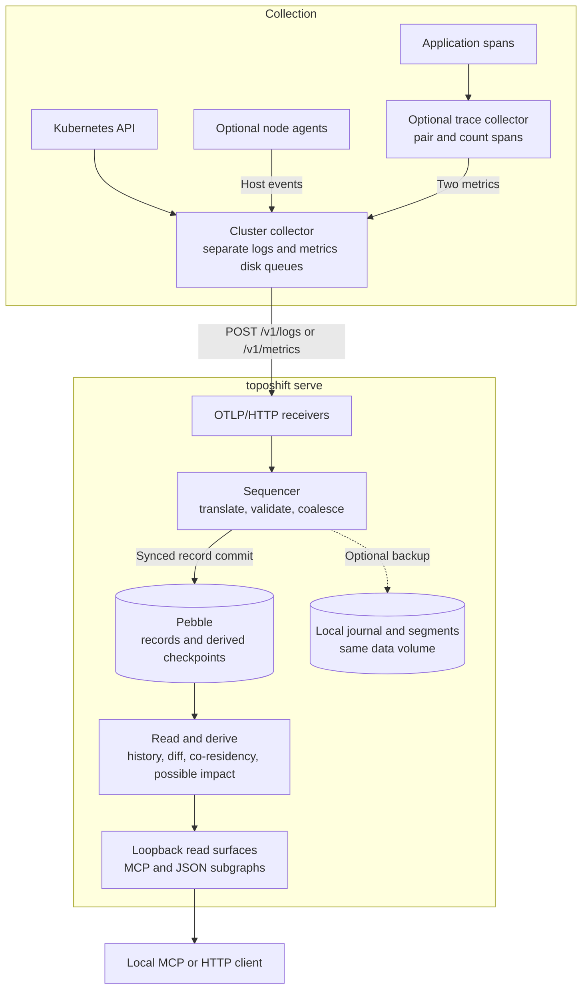

# System overview

toposhift records what infrastructure observers asserted, then reconstructs how entities and relationships existed at a past instant or over a window. Collectors supply observations; read-only queries derive answers from them. A blast radius describes possible exposure under the graph's propagation rules, rather than measuring actual application failure.

Arrows show data flow. The backup branch is optional and off by default. These boxes describe supported configurations and code, not an already deployed cluster. The JSON subgraph routes are [newer than v0.1.0](api.md). The collector configurations need deployment credentials, volumes and network restrictions.

## Collection and writes

The cluster collector sends Kubernetes/node-agent logs and trace metrics through separate persistent queues. Each queue preserves its own export order; the collectors do not impose a combined order on logs and metrics. The sequencer assigns one ingest order after the requests reach toposhift. The trace collector's upstream queue is in memory. See the [collection flow](../deploy/otel-collector/README.md#collection-flow) for the two paths and their limits.

Both streams reach the sequencer. It translates observations, checks records, coalesces repeated assertions and assigns ingest sequence numbers. Successful acknowledgement follows durable record storage; OTLP partial success can still report rejected input. An outage can exhaust a collector's queue, and missing observations cannot be recovered from the stored graph alone.

## Reading the history

Every record has event time and an ingest sequence. Queries pin one sequence token, reconstruct lifetimes and join paths by interval overlap. Edges that existed at different times cannot form one valid path merely because they appear in the same window. Checkpoints are derived summaries that shorten reads; late records can invalidate them. Derived query results are never written back as asserted facts.

See [answering a window query](how-it-works.md#answering-a-window-query) for the reconstruction steps. Keep attribution gaps, quarantine, truncation and provenance beside each result. Retention can refuse older history or descriptions. A sequence token is not a wall-clock timestamp; arbitrary ingest-wall-time lookup is not implemented.

| Mode | Store and access |
|---|---|
| `serve` | Opens durable Pebble storage when a usable data directory exists. On loopback, serves MCP at `/mcp` and JSON under `/api/v1/subgraph/`. A non-loopback listener accepts ingest but leaves both read surfaces unmounted. |
| `mcp` or `query` | Opens an existing store read-only. The store lock is exclusive: stop its other owner first. `mcp` serves over stdio; `query` prints command results. Give the store directory itself, normally `DATA_DIR/store`. |
| `demo` | Builds a labelled synthetic world through the ingest path into memory, then serves the tools over HTTP or stdio. |

## Current boundaries

Loopback is not authentication. Forwarding a port can expose every mounted route; it does not create a protected read-only service.

When enabled, local backup journals batches and cuts committed activity into segments. It shares the live store's volume. Backup failure is reported separately and does not redefine the store's commit acknowledgement.

Access verification and S3 segment libraries exist, but `serve` has no integrated authenticated public listener or off-volume backup mirror. The CLI has no restore command. See [operation](operate.md) and [current limits](limits.md) before deployment.

For implementation details, start with the [sequencer contract](../internal/ingest/sequencer/doc.go), [interval reads](../internal/query/interval/doc.go) and [backup writer](../cmd/toposhift/backup.go).
