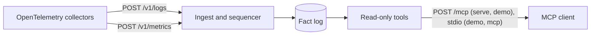

# How toposhift works

This page is for a reader who wants to know what toposhift stores, what it computes, and what an answer's labels mean. For comparisons with other approaches, see section 1 of the [findings report](../bench/findings/REPORT.md#1-what-was-compared-and-what-was-not). The [README](../README.md) has the short version.

## The path of a record

Collectors read a cluster and send what they see to `toposhift serve`. Logs carry pods, nodes, containers and hosts. Metrics carry services and the calls between them. Ingest turns each request into records, gives each an ingest sequence number, and writes them to the store. The tools only read it.

## Facts and derived answers

The fact log holds only two kinds of record: what a producer asserted about an entity or a relation, and events the store itself authored, each attributed to its author. Nothing else is written as a fact.

Everything else is derived.

A blast radius, the pods that shared a node, a service's context and a `same_as` projection are computed when you ask. A checkpoint is computed by the store to shorten reads, and is labelled derived.

A derived answer says `"derived": true`: it was computed from records at a token under a policy version, and it is never written back as a fact. If it were, a later reader could not tell what a producer said from what toposhift worked out.

## Two time axes

Every record carries two times: the event time, when the thing happened according to its producer, and the ingest time, when toposhift learned of it. A question about "the world at 03:00" uses event time. A `token` names a state of the store by ingest order, so an answer read at that token does not change when later records arrive.

## Entities, relations and layers

An entity has a type and an id. The id is a hash of the entity's exact identifying attributes, so the same attributes always give the same id; `resolve_entity` computes it. Types sit in layers, which differ in how often their entities change:

| Layer | Holds | Meaning |
|---|---|---|
| L0 | Racks, switches, ports | The physical fabric; changes in weeks |
| L1 | Hosts and zones | Host placement; changes in hours |
| L2 | Nodes, pods, containers, processes, service instances, endpoints | Workload placement; changes in seconds |
| L3 | Services | Logical dependency between services |

Relations connect entities. `describe_schema` lists them all:

- `scheduled_on` (pod to node), `part_of` (container or service instance to pod), `runs_on` (node or process to host) and `located_in` (host to rack or zone). Failure travels down: when the substrate fails, what runs on it is degraded.
- `depends_on` (service to service). Failure travels up: when a callee fails, its callers are degraded.
- `instance_of` (service instance to service) and `has_address` do not carry failure. `same_as` is derived.

A relation exists only while both of its ends exist.

## Spans and why they end

An entity or a relation exists over spans of event time.

Each span ends for a reason that `entity_history` reports: the producer deleted it (`producer`), it passed its time to live (`liveness_expiry`), an endpoint ended (`cascade`), retention moved past it (`retention`), or an operator purged it (`operator`); `unattributed` means the source is not known, and a span that reaches the end of the window has no reason (`null`).

A span that was not seen again is not deleted; it ends at the time it expired, and the reason says so.

## Late records

A record can arrive after later ones. toposhift diffs a late record against the record just before it in event time, never against the current state, and invalidates any checkpoint built after it. A late record is placed where it belongs in event time.

## Paths and co-residency

A path of two or more edges, and a co-residency, are valid only if the intervals of every edge on it overlap.

They are checked by interval intersection, never by walking a union graph of every edge that ever existed. Two pods are co-resident if they were scheduled on one node at once, or on two nodes that were each placed on one host at once. A placement or a mapping that cannot be told is listed as unattributed, never guessed.

## Checkpoints

A checkpoint saves the folded state of an entity's history so that a read need not fold it from the start. A checkpoint is derived: it carries the version of the fold logic and the ingest sequence number it was built through, and it is never a fact.

## Identity

Identity is matched exactly: no trimming, no case folding, no search. Where an identity or an IP address cannot be attributed with certainty, toposhift says `unattributed` rather than guess. A clone collision, where two live entities claim one identity, is a loud error and not a silent merge.
